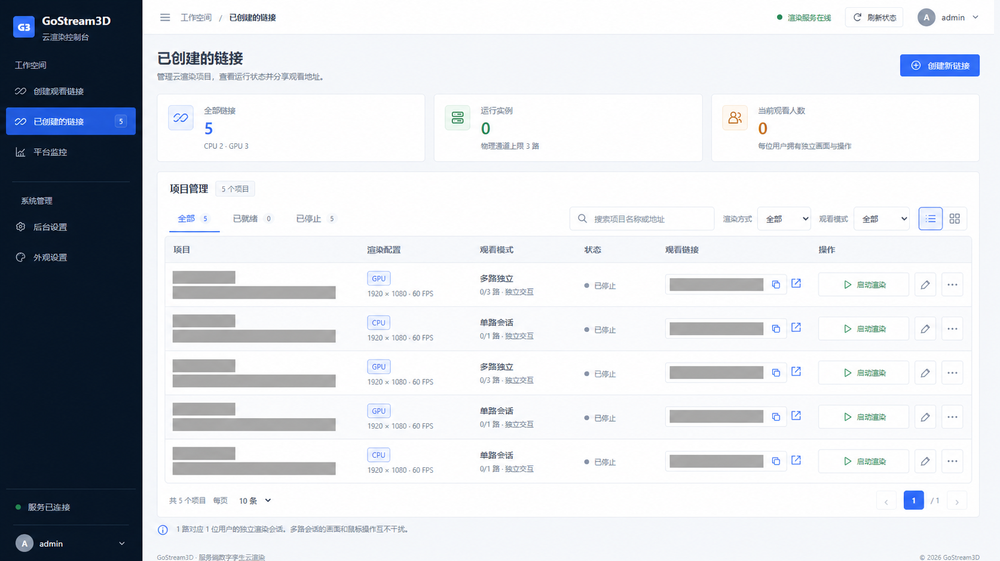
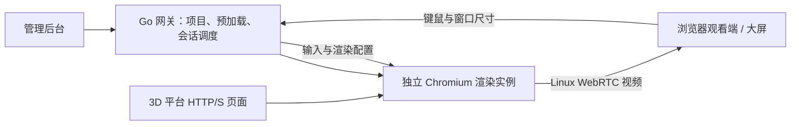

# GoStream3D

**将服务器上的 3D 网页变成可分享、可交互的云渲染画面。**

GoStream3D 使用 Go 管理服务端 Chromium，提前加载 3D 页面、模型与纹理，将渲染结果传给观看端，并把键盘、鼠标、滚轮操作回传到对应浏览器。观看设备接收画面，无需运行原始场景的 WebGL 渲染。

适用于数字孪生、智慧园区、工厂可视化、BIM 演示、展厅与大屏展示。支持服务器可访问的 HTTP(S) WebGL 链接，不限于 ThingJS；不同平台的兼容性仍需使用实际场景验证。

[Docker Hub 网关](https://hub.docker.com/r/ncayu8847/gostream3d-gateway) · [Docker Hub 渲染器](https://hub.docker.com/r/ncayu8847/gostream3d-neko-chromium) · [在线部署](docs/docker-hub-deploy.md) · [配置与使用](docs/development-reference.md)

## 功能

| 能力 | 说明 |
| --- | --- |
| 项目与观看链接 | 创建、编辑、启停项目，生成观看链接，支持项目备份与恢复 |
| 页面预加载 | 观看前加载页面、模型与纹理，后台展示就绪状态和失败原因 |
| 独立会话 | 每位观看者分配独立浏览器、画面和输入，不同用户的操作互不干扰 |
| CPU / GPU | 保留纯 CPU 模式；Linux 支持 NVIDIA 硬件 WebGL + NVENC，以及 Intel WebGL + VA-API |
| 大屏画质 | GPU 自适应物理像素，尺寸最高按比例限制在 3840×2160，保留固定分辨率；NVIDIA 编码预算随尺寸和帧率调整 |
| 渲染与交互优化 | 改善兼容 WebGL2 深度缓冲的远景遮挡与闪烁，保留多重采样和深度纹理兼容性；减少旧帧积压，优化鼠标、滚轮和远端指针显示 |
| 逐路画面性能 | Linux WebRTC 观看端报告接收 / 显示 FPS、实际尺寸、编码、码率、解码、缓冲、RTT 和丢包 / 丢帧 |
| 资源监控 | CPU、内存、磁盘分区、网络，以及 NVIDIA GPU 型号、显存、GPU / 视频编码器使用率 |
| 资源调度 | 服务器总通道、项目会话配额、预加载路数与空闲实例回收；Linux cgroup v2 共享 CPU 上限 |
| 管理控制台 | 管理员账号修改、持久化配置、响应式布局与主题切换 |



截图与测试记录中的真实项目信息已脱敏，说明见 [公开资料脱敏](docs/publication-privacy.md)。

## 工作方式



Linux 渲染实例基于定制 Neko 3.1.5、Chromium、Xorg 与 GStreamer。Windows 本机模式使用独立 Edge / Chromium，通过 JPEG 与 WebSocket 传输画面；Linux NVENC 的能力不等同于 Windows 本机链路能力。

## 平台与硬件

| 环境 | 渲染 / 编码 | 额外要求 |
| --- | --- | --- |
| Linux CPU | SwiftShader WebGL / VP8 软件编码 | Docker；复杂场景推荐 GPU |
| Linux NVIDIA | 硬件 WebGL / NVENC H.264 | NVIDIA 驱动、Container Toolkit、已注册的 `nvidia` runtime、H.264 NVENC 能力 |
| WSL2 NVIDIA | Mesa D3D12 / ANGLE GL / NVENC H.264 | Windows NVIDIA 驱动、DXG / WSL 图形库、Linux Container Toolkit |
| Linux Intel | ANGLE Vulkan / VA-API H.264 | 实际 Intel render 节点与兼容硬编能力 |
| Windows 本机 | CPU / GPU 浏览器渲染、JPEG 画面传输 | Edge / Chromium，见 Windows 发行说明 |

当前 Docker 镜像平台为 **Linux amd64 / x86_64**，需要 Docker Engine 25+ 和 Compose 2.20+。GPU 模式检查实际 WebGL renderer，发现 llvmpipe / SwiftShader 会报告错误。WSL2 使用 Windows 显卡驱动，不在 WSL 内安装 Linux NVIDIA 内核驱动。

## 快速部署：Linux Docker

推荐成套部署网关和渲染器。当前固定版本为 `20261010-110721`；滚动标签适合跟随更新，生产部署和回滚建议使用固定版本。

```bash
git clone https://github.com/ncayu/GoStream3D.git
cd GoStream3D
sudo docker pull ncayu8847/gostream3d-gateway:20261010-110721
sudo docker pull ncayu8847/gostream3d-neko-chromium:3.1.5-20261010-110721

# 仓库的 Compose 使用本地兼容标签；CPU 和 GPU 两个标签都要设置
sudo docker tag ncayu8847/gostream3d-gateway:20261010-110721 gostream3d/gateway:latest
sudo docker tag ncayu8847/gostream3d-neko-chromium:3.1.5-20261010-110721 gostream3d/neko/chromium:3.1.5
sudo docker tag ncayu8847/gostream3d-neko-chromium:3.1.5-20261010-110721 gostream3d/neko/nvidia-chromium:3.1.5

# 必须将示例 IP 改为观看设备可访问的服务器 IP
cp scripts/start-docker.sh ./start.sh
sudo bash start.sh --public-ip 192.168.1.100
```

启动后访问 `http://服务器IP:8888/admin`。全新初始化账号为 `admin` / `Admin@2026.com`，初始配置位于 `data/config.env`；首次登录后在后台“修改账号密码”中设置自己的账号密码。已有数据保留原账号和项目。

登录后创建项目，填写服务器可访问的 3D 网页 URL，选择 CPU 或本机 GPU，设置分辨率、帧率和会话配额，启动预加载；就绪后打开生成的观看链接。

默认开放 TCP **8888** 和 UDP **52000–52023**。公网 / NAT 还需配置转发；增加通道数量时同步调整端口池。网关通过 Docker socket 创建 Worker，部署主机应可信，后台对外服务建议使用 HTTPS。

### NVIDIA / Intel 配置

NVIDIA 主机已安装驱动与 Toolkit 后，在 Compose 同目录 `.env` 设置：

```dotenv
GOSTREAM3D_GPU_BACKEND=nvidia
GOSTREAM3D_GATEWAY_RUNTIME=nvidia
```

WSL2 还需 `GOSTREAM3D_GPU_LIBRARY_DIR=/usr/lib/wsl`。Intel 可设 `GOSTREAM3D_GPU_BACKEND=intel`，必要时指定实际 `GOSTREAM3D_GPU_RENDER_DEVICE`。修改后重建网关；详细条件与诊断见 [Linux GPU 渲染](docs/linux-gpu-rendering.md)、[NVIDIA / WSL2](docs/linux-nvidia-wsl-rendering.md) 和 [资源控制](docs/linux-resource-control.md)。

### 必须正确配置观看端 IP

**`GOSTREAM3D_ICE_PUBLIC_IP` 必须由部署者填写 / 核对。** 同一局域网使用观看端可达的服务器 LAN IP；公网观看使用可达的公网 IP。填写纯 IP，不带协议、路径或端口，不照抄容器或仅在 WSL 内可达的虚拟地址。

配置优先级是 **容器环境变量 > `data/config.env`**。仓库 Compose 将 `.env` 的 IP 显式传入容器，因此只修改 `data/config.env` 不会覆盖容器环境中的旧 IP。请同步核对两处，修改 `.env` 后执行：

```bash
sudo docker compose config --quiet
sudo docker compose up -d --force-recreate --wait --wait-timeout 90 --pull never gateway
sudo docker compose exec -T gateway printenv GOSTREAM3D_ICE_PUBLIC_IP
```

`restart` 不会更新已有容器环境。重建会中断当前观看连接；完成后重新预加载并刷新观看页。完整字段示例见 [网关配置说明](docs/docker-hub/gateway-overview.md)。

两个 `NEKO_*_PASSWORD` 是自动生成的独立内部凭据，保留本机生成值。后台修改后的账号保存在 `data/admin-account.json`，优先于初始账号配置，详见 [管理员账号修改与恢复](docs/admin-account.md)。

## 画质与性能边界

最高 4K 表示支持的尺寸范围，实际 FPS 取决于硬件、显存、场景复杂度、并发与网络；不承诺所有场景稳定 4K30 / 60。H.264 / NV12 为有损编码，不能保证逐像素无损。大屏应用应使用最终屏幕、实际场景和目标并发验收。

通用深度优化覆盖 Linux GPU 的 WebGL2 页面上下文、跨域及嵌套 iframe。WebGL1、WebGPU、Worker 内渲染和需要原始深度纹理格式的路径保持原行为；源平台自身的时域抗锯齿残影、重叠模型与材质问题仍需单独排查。

逐路 WebRTC 指标由观看端每 3 秒报告，无观看连接时不产生有效测量。解码、缓冲与 RTT 不等于完整操作到画面的延迟。GPU 利用率与显存当前接入 NVIDIA；Intel 硬件渲染支持不代表已接入 Intel 利用率趋势。

## 源码构建与验证

网关模块要求 Go 1.24+；定制 Neko 模块要求 Go 1.25+，建议统一使用 Go 1.25。前端使用 Node.js / npm，版本应满足锁文件中 Vite 的引擎要求。

```bash
cd web
npm ci
npm test
npm run build
cd ..

# 更新嵌入资源后构建；归档源码已包含最新嵌入资源
cp web/dist/index.html internal/api/static/index.html
cp web/dist/assets/* internal/api/static/assets/
go test ./cmd/... ./internal/...
go build -o gostream3d ./cmd/server
```

Windows PowerShell 可用 `scripts/build-release.ps1` 完成前端构建、资源同步及 Linux 网关编译；源码 Docker 成套打包使用：

```powershell
# 源码仓库不提交 Go vendor；先按 Neko 锁定版本恢复构建依赖
Push-Location neko-3.1.5/server
go mod vendor
Pop-Location
pwsh -NoProfile -File scripts/package-docker-release.ps1 -MirrorECR -Validate
```

Worker 画质预算测试：在 `neko-3.1.5/server` 执行 `go test ./pkg/quality`。浏览器深度回归：在安装 Playwright 并准备浏览器后，在 `web` 执行 `npm run test:depth:browser`。GPU / NVENC 完整验收需要目标硬件，不以 CPU 容器回归替代。

## 文档与目录

| 内容 | 入口 |
| --- | --- |
| Docker 在线部署与升级 | [docker-hub-deploy.md](docs/docker-hub-deploy.md) |
| 离线镜像部署 | [docker-linux-deploy.md](docs/docker-linux-deploy.md) |
| GPU 大屏画质与深度优化 | [画质说明](docs/linux-gpu-quality.md)、[深度稳定性](docs/linux-gpu-depth-stability.md) |
| 逐路画面性能 | [linux-stream-performance.md](docs/linux-stream-performance.md) |
| Linux CPU / GPU 资源控制 | [linux-resource-control.md](docs/linux-resource-control.md) |
| Windows / Linux 二进制发行 | [binary-release.md](docs/binary-release.md) |
| 配置、API 与实现细节 | [development-reference.md](docs/development-reference.md) |

```text
cmd/                 Go 网关入口
internal/            项目、渲染调度、输入、配置与监控
web/                 React / TypeScript 管理后台与观看页
neko-3.1.5/           定制 Neko、Chromium 启动与渲染运行环境
deploy/              Dockerfile、Compose 配置与容器入口
scripts/             构建、发行、部署与回归脚本
docs/                使用说明、界面示例与技术验证记录
openspec/            需求与变更记录
```

提交问题时请提供系统 / Docker 版本、GPU 型号、渲染模式、分辨率、复现步骤及脱敏日志。不要提交实际配置、密码、项目数据或浏览器档案。

## 第三方组件

渲染器基于 [Neko](https://github.com/m1k1o/neko) 定制，保留其 [Apache-2.0 许可证](neko-3.1.5/LICENSE) 及组件版权文件。Chromium、GStreamer、Xorg 与其他依赖遵循各自许可；第三方许可不自动授予 GoStream3D 自有代码相同许可。
